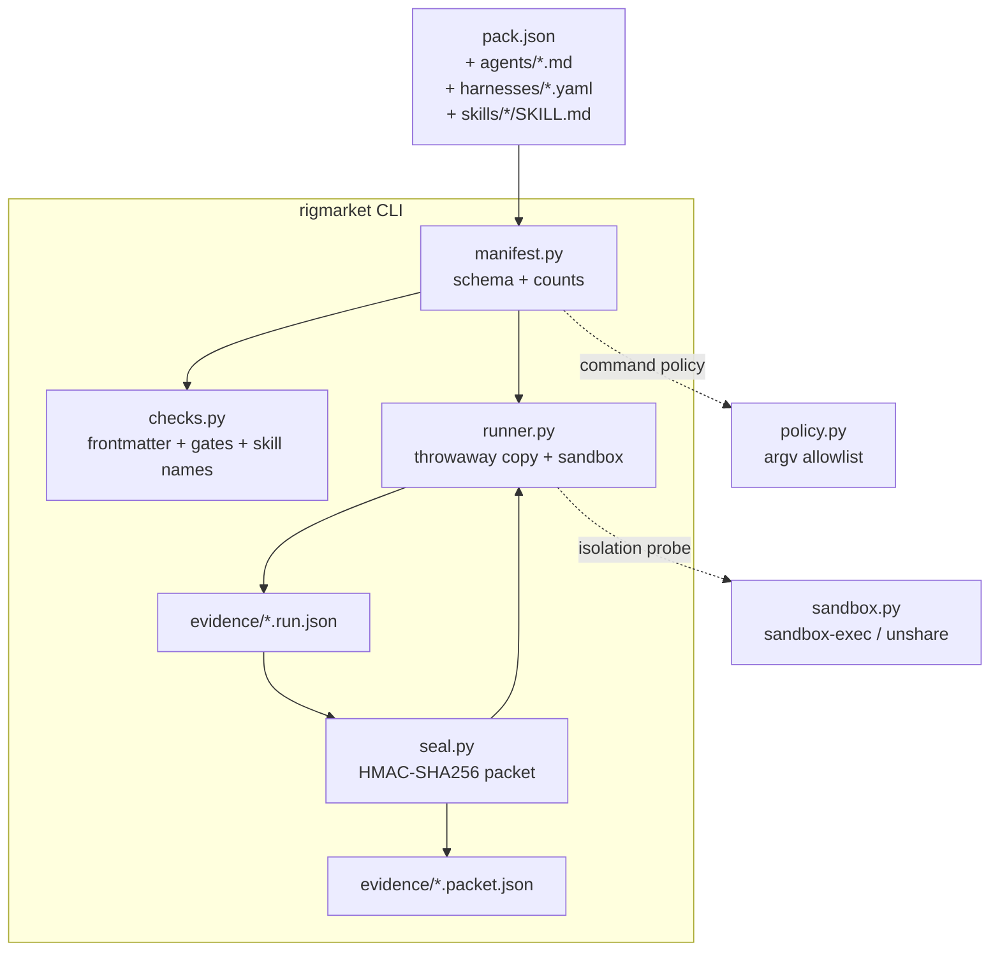
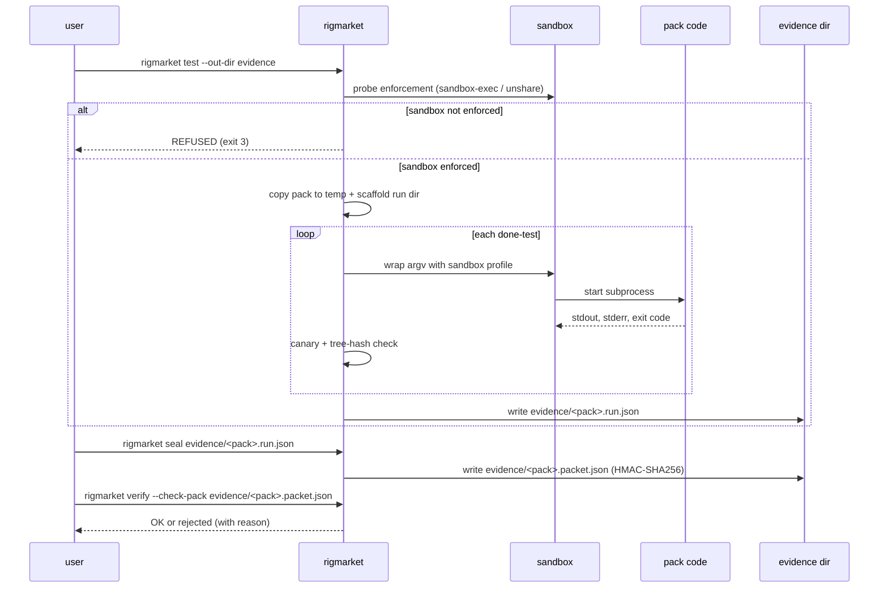

# Architecture

This document describes how `rig-marketplace` is built. Read the source
alongside it; every claim here has a file path under the repository root.

## Three layers

1. **Pack directory** — every pack ships `pack.json` (JSON Schema 2020-12),
   `PACK.md` (human-readable summary), and the three content kinds
   declared by `contract.provides`: agents (`*.md` with YAML frontmatter),
   harnesses (`*.yaml` with a top-level `harness_id`), and skills
   (`<name>/SKILL.md` plus an optional `<name>/run.py`).
2. **rigmarket CLI** — `src/rigmarket/` is a small Python package:
   `manifest.py` parses and validates `pack.json`; `checks.py` runs the
   structural checks the bundled done-tests call out;
   `runner.py` copies a pack to a temp directory, calls
   `sandbox.wrap(...)` to confine each subprocess, and records a
   `rig.run.v1` document; `seal.py` HMAC-signs the run into a
   `rig.proofpacket.v1` and verifies it later.
3. **Policy and isolation** — `policy.py` is an argv allowlist (today
   only `{python}` plus the policy-shaped subset of `python -m` /
   `python <file>`); `sandbox.py` describes the OS-level confinement
   backend and probes whether it is enforced before any pack code runs.

## The `rig.pack.v1` contract

The schema lives at `src/rigmarket/pack.schema.json` and is loaded via
`manifest.load_schema()`. Validation has three rounds:

1. **JSON Schema** — the document parses and the required fields are
   present (`schema`, `name`, `version`, `description`, `contract`,
   `permissions`, `done_tests`).
2. **Declared counts** — `contract.provides.{agents,harnesses,skills}`
   must equal the number of files on disk under the matching directory.
3. **Done-test policy** — each `done_tests[].run` argv list is run
   through `policy.run_errors(...)` and rejected at schema time if it
   names a forbidden command, uses placeholder names outside the small
   allowlist, or uses interpreter flags other than `-m`.

## Run and prove

The packet stores a key fingerprint, never the key; `verify` rejects
unsigned, edited, uncontained, failed-test, or changed-pack packets.
See `src/rigmarket/seal.py` for the exact rules.

## What `$(rig-builds)` is and is not

Agent and skill files reference paths under `$(rig-builds)` — a
parameterized placeholder, not a host directory:

- `$(rig-builds)` is **never** expanded by the catalog validator; it
  is a documentation variable the agent reads in its own context.
- The first pack release ships no canonical contents under
  `$(rig-builds)`; that path is **the host's** build workspace, set
  by the operator who adopts the catalog in their fleet.
- The validator never reads or writes outside the pack tree, so
  replacing `~/Developer/...` with `$(rig-builds)/...` removes a
  machine-path leak without changing catalog behavior.

If you maintain a derivative catalog, define `$(rig-builds)` to
whatever your fleet's build workspace is and document it once at the
top of your fork's README. The validator does not look it up.

## Where to extend

| To change | Edit |
|---|---|
| A new structural check | `src/rigmarket/checks.py` and a fixture in `tests/test_checks.py` |
| A new argv policy class | `src/rigmarket/policy.py` (`declared_command_errors`, `run_errors`) and a test in `tests/test_policy.py` |
| A new isolation backend | `src/rigmarket/sandbox.py` (`describe`, the `wrap` callable); CI must probe it before any default-mode test runs |
| The schema | `src/rigmarket/pack.schema.json`, then a `tests/test_manifest.py` case |
| A new CLI command | `src/rigmarket/cli.py` (`cmd_*`) and a `tests/test_cli.py` invocation |

## Performance budget

`rigmarket validate` on the five bundled packs (122 agents, 32
harnesses, 23 skills) finishes in well under one second on a single
core. `rigmarket test` adds one process per done-test plus the
sandbox-init cost; on macOS the default flow runs 25 done-tests in
about five seconds. The cost is dominated by per-test subprocess
startup, not by Python.
